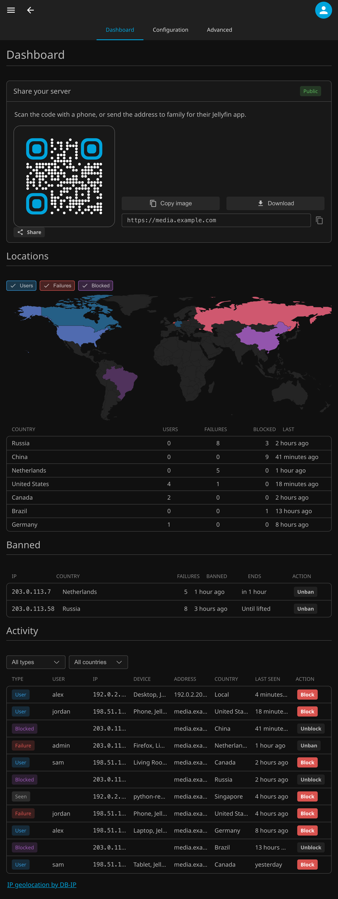

# Dashboard & Monitoring

The **Dashboard** tab shows who reaches your server through Remote Access, where from, and what was turned away.
It is the page the **Remote Access** entry in the dashboard's side menu opens on, and it refreshes itself every 30 seconds.

## Share Your Server

Once Remote Access has an address, the **Share your server** card at the top shows it with a QR code. It is the
proxy's first public name, the DDNS record's hostname in step 2 of the **Configuration** tab. A **Public** badge means
anyone can open it, and **Home only** means only your home network can.

* Scan the code with a phone camera to open the address.
* **Copy image** puts the QR code on the clipboard, and **Download** saves it as a picture. The copy button beside the
  address puts the address on the clipboard.
* **Share** opens the device's share sheet, on browsers that have one.
* When the only address is one your home network alone knows, such as `nas.lan`, the card shows **Home only** and a note,
  since phones outside cannot open it. Choose a public address in step 2 to share it outside.
* The card stays hidden while the proxy is off, or has no address other than a wildcard.

## Locations

A world map and a table of countries.

* **Users**, **Failures** and **Blocked** above the map turn each kind on or off. All three are on when the page
  opens.
* On the map, users are blue, failed sign-ins red, and blocked visitors purple. A country with several kinds mixes
  their colours, and the more activity, the stronger the colour.
* The table has a row per country, with the number of users, failed sign-ins and blocked visitors, and when the
  country was last seen. A column shows only while its kind is on.
* Selecting a country on the map selects its row, and selecting a row highlights its country.

## Banned

Addresses banned for failed sign-ins: the **IP**, its country, how many failures, when it was banned and when the
ban ends. **Unban** lifts it straight away, together with any wider ban on the same IPv6 network.

How many failures ban an address, and for how long, is set under **Advanced > Blocking**. See
[Protection](RemoteAccess.md#protection).

## Activity

Every address that reached the proxy, newest first, up to the latest 500. Filter it by **Types** and **Countries**.
The **Countries** filter also has **Local**, for visitors from your own network.

| Type | Meaning |
|---|---|
| **User** | Signed in, with the user and device. |
| **Failure** | A sign-in that failed, with the username that was tried, whether or not that user exists. |
| **Blocked** | Turned away by a ban, the block list or the country rules. |
| **Seen** | Reached the sign-in page and did nothing else. |

Each row shows the **Type**, **User**, **IP**, **Device**, the **Address** it asked for, its **Country** and when it
was **Last seen**.
With **Location** set to **Country and city**, an **Area** column adds the city.
Visitors from your own network show as **Local**. IPv6 visitors are grouped by their /64, since one device can use
many addresses in it.

The button at the end of a row acts on it:

* **Unban** lifts the ban on an address that is banned, as on the Banned table.
* **Block** adds the address to the block list. Your own network and trusted networks cannot be blocked.
* **Unblock** removes it. An address blocked by a range under **Advanced** is unblocked there instead.
* **Unblock** on a country turned away by the country rules allows that country from then on.

## What Is Recorded

History is on by default and kept for 90 days. Change it under **Advanced > History**, listed in the
[Settings Reference](Settings.md#history). With **Record history** off the Dashboard stays empty, but bans and blocks
still work. **Clear history** deletes everything recorded and keeps the block list.

Locations come from the free [DB-IP](https://db-ip.com) database, downloaded to this server. Addresses are looked up
on the server itself and never sent anywhere. The history is kept in `people.db`. See [Storage](Security.md#storage).

## Monitoring

The Dashboard tab covers visitors. The DDNS record and the plugin itself report in two other places.

### Record Status

The status card in step 2, **Address**, of the **Configuration** tab shows how the DDNS record is doing:

* **Public IP**: the address the server was last seen at.
* **Last update**: when the record was last checked.
* **Result**: what the last check did, in green when it worked and red when it failed, or **Paused** when updates
  are off under **Advanced > Dynamic DNS**.

When the proxy is off, the step says **Up to date** once the last check worked within the last 24 hours,
**Failing** when it did not, and **Not updated yet** before the first one.

### Activity Log

The plugin writes what it does to Jellyfin's activity log, which is part of Jellyfin's own dashboard, not the
plugin's **Dashboard** tab. Changes you make are credited to you.

Each entry has a level:

* **Error**: something people rely on is broken. A record is left on an old address, the proxy did not start,
  there is no working certificate, Jellyfin does not answer through the proxy, the proxy cannot be reached from
  outside, or the plugin cannot use its own files.
* **Warning**: something needs attention but still works. A certificate expires soon, a renewal failed while the
  current certificate is still valid, a record is paused, an address was banned, the router did not open the
  ports, or a Let's Encrypt TXT record was left at the provider.
* **Information**: everything else.

A problem is written once when it starts, and once more when it clears, not on every run. A run where every
record is already current writes nothing.

Every entry has the same shape: a short name such as **Certificate renewed** or **203.0.113.7 banned**, over one
sentence saying what happened. Where many of one thing happen together, they are summed into one entry per outcome,
named with the count, such as **3 DNS records updated**, whose sentence lists each one with its count, such as
"Updated for a.example.com (1), b.example.com (1), c.example.com (1) to 203.0.113.5 (3)".

#### Dynamic DNS Entries

Each update run writes one entry per outcome, listing the records by hostname.

* **DNS records updated**: records were sent a new address, listed with the address. Refreshing the same address
  only goes to the server log.
* **DNS records failed**: the provider refused the update or could not be reached, listed with each reason. It is
  an error when a record is left on an old address, and a warning when DNS already has the current one, as after a
  failed refresh.
* **DNS records recovered**: records that were failing updated again.
* **DNS records paused**: records were paused after repeated failures, once per streak, with when the next try is.
* **Public IP detection failing**: no public IP was found for about an hour, with **Public IP detection recovered**
  when it is found again.
* **DNS records added**, **changed** or **removed**: one entry each per save. **Credentials changed for** a record
  is always its own entry. **Dynamic DNS settings changed**: the settings under **Advanced > Dynamic DNS** changed.
* **Credential encryption unavailable**: an error when the plugin could not set up its encryption keys, once per
  outage. No credential can be saved until it can. Reinstall the plugin, then check the permissions on its folders.
* **File access failed**: an error when Jellyfin runs as an account that cannot open the plugin's folders, naming
  the command that fixes it. See [Recovery](RemoteAccess.md#recovery).

#### Remote Access Entries

* **Proxy settings changed**: a tab was saved with a change, naming what changed.
* **Proxy failed to start**: once per reason, such as a port in use, with **Proxy started** when it starts. With
  **Only through the proxy** on, Jellyfin stays on this server alone, and the entry says how to turn the proxy off
  by hand. See [If the proxy stops working](RemoteAccess.md#if-the-proxy-stops-working).
* **Trust the proxy**: **Proxy trust turned on** when Jellyfin was set to trust the proxy, **Proxy trust confirmed**
  or **Proxy check failed** after the restart, and **Network settings restored** when **Undo** put its settings back.
* **Router ports**: written once when something changes, not on every hourly renewal.
    * **Ports 80 and 443 opened on router**: names the device that answered, the address the
      ports go to and whether UPnP or NAT-PMP was used, and says when that device is not this server's default
      gateway. Before a certificate is ready, only port 80 is opened. See
      [Checking the forward](RemoteAccess.md#checking-the-forward).
    * **Router ports failed to open**: a warning with the router's reason, such as a port
      another device already holds.
    * **Router not found**: a warning that no router answered over UPnP or NAT-PMP.
* **External access failed**: an error when the **Verify external access** task finds that no outside
  place can connect to port 443, naming each place and why it failed, with **External access restored** when it works again. A check
  the outside service could not run, such as when it is busy, only goes to the server log.
* **Certificates**: **Certificate issued**, **Certificate renewed**, **Certificate request failed**, **Certificate
  renewal failed**, **Certificate failed to load** or **Certificate expiring soon**. **Certificate requested** is
  logged with who asked.
* **Root certificate created**: the plugin made a new self-signed root, naming what it may vouch for. Every device
  that should trust the self-signed certificate needs it installed, in place of any earlier one. See [Self-signed certificates](RemoteAccess.md#self-signed-certificates).
* **TXT records left over**: Let's Encrypt TXT records could not be removed from the provider, one entry per
  cleanup. It is a warning. The records do no harm, but you can delete them there.
* **Bans**: each ban is its own entry, such as **203.0.113.7 banned**, with the failed sign-ins and the country.
  Past five bans in a minute, the rest are summed into one entry listing the countries, such as **3 clients banned**.
  **Ban lifted for** an address is logged too.
* **Blocks**: an address was blocked or unblocked, or a country unblocked, from the Dashboard, such as
  **203.0.113.7 blocked**.
* **Connections refused**: an hourly summary of what the block list, bans, country rules and connection limits
  turned away, such as "Internet connections were refused in the last hour by the country rules (9), bans (3)".
* **Most visitors seen as local**: see [When every visitor looks local](RemoteAccess.md#when-every-visitor-looks-local).
  Logged once.
* **Location database update failed**: downloading it failed, once per reason, with **Location database updated**
  when it works again.
* **History settings changed**: **Record history**, **History period** or **Location** was changed.
* **History cleared**: every recorded visit, sign-in and refusal was deleted.
